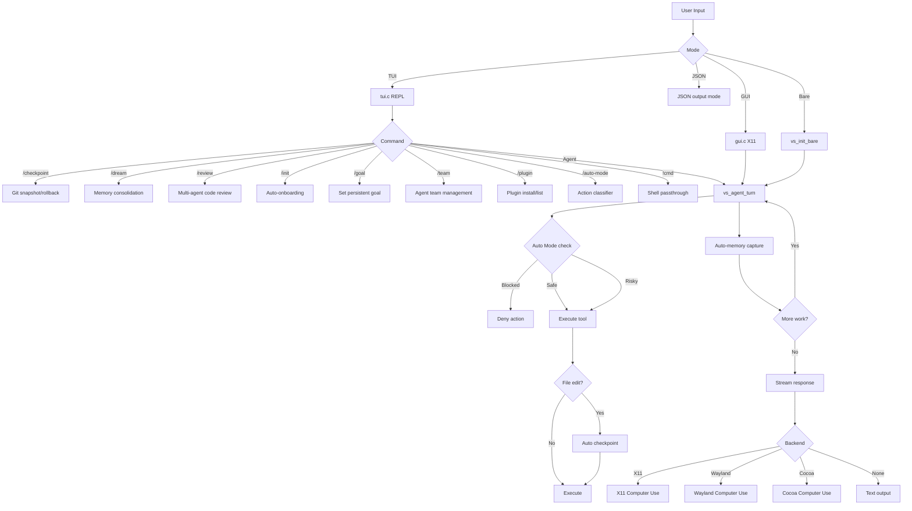

# Claude Code Full Parity — Phase 4: Advanced Features & Cross-Platform Computer Use

### Overview

VibeSolaris Phases 1-7 are complete: all 18 Claude Code built-in tools, 25+ extras, context window awareness, subagent improvements, TUI integration, EndConversation, CLAUDE.md loading, `/fork`, `--bare` mode, auto-memory, accessibility mode, image display, conversation save/restore, X11/Wayland/Cocoa Computer Use, checkpoints, AutoDream, Auto Mode, Agent Teams, Plugins, Code Review, CLI flags, full LSP, multi-layer settings, project index, TUI themes, suggestions, editor, mouse selection, scrollback search, effort for all providers, keyboard shortcuts (Ctrl+T, Ctrl+R, Shift+Tab), LSP status bar, and Phase 7 reasoning engine (chain-of-thought, self-correction, confidence scoring, task decomposition, proactive suggestions). **887 tests, 548 KB binary. All phases 1-7 fully complete with no deferred items.**

Phase 4 adds the remaining Claude Code features for complete parity: Checkpoints (git snapshots), AutoDream (memory consolidation), Auto Mode (action classifier), Agent Teams (peer-to-peer agents), Plugins (bundle system), Code Review mode, Away Summary, `/goal`, `/init`, `/dream`, effort levels, `--worktree`/`--resume` flags, JSON output mode, keybindings customization, output styles, PDF reading, `!` shell passthrough mode, keyboard shortcuts, and **optional Wayland and Cocoa Computer Use modules** for Wayland and macOS systems.

### What VibeSolaris Has Today (All Phase 1-4 features complete, 533 tests, 477 KB binary)

| Claude Code Feature | VibeSolaris Status |
|---|---|
| ✅ Read, Write, Edit, Bash (run) | ✅ `agent.c` native tools |
| ✅ WebSearch, WebFetch | ✅ `src/web.c` |
| ✅ TodoWrite (task list) | ✅ `src/todo.c` |
| ✅ Subagents (parallel) | ✅ `src/coordinator.c` |
| ✅ Skills system | ✅ `src/skill.c` |
| ✅ Persistent Memory | ✅ `src/memory.c` |
| ✅ MCP (stdio + HTTP) | ✅ `src/mcp.c` |
| ✅ Plan/Approval workflow | ✅ `src/workflow.c` |
| ✅ Context compaction | ✅ `agent.c` `agent_compact()` |
| ✅ Streaming responses | ✅ `src/tui_stream.c` |
| ✅ OAuth (OpenAI + Claude) | ✅ `src/oauth.c` |
| ✅ Parallel tool executor | ✅ `src/tool_executor.c` wired into agent |
| ✅ TUI compositor | ✅ `src/tui_compositor.c` wired into REPL |
| ✅ Glob (pattern file search) | ✅ `src/glob.c` |
| ✅ Grep (content search) | ✅ `src/grep.c` |
| ✅ NotebookRead/NotebookEdit | ✅ `src/notebook.c` |
| ✅ Monitor (background process) | ✅ `src/monitor.c` |
| ✅ MultiEdit (multi-hunk edits) | ✅ `src/multi_edit.c` |
| ✅ KillShell / BashOutput | ✅ `src/monitor.c` |
| ✅ TaskCreate/TaskUpdate/TaskList | ✅ `src/task.c` |
| ✅ Permission rules (allow/deny) | ✅ `src/permission.c` |
| ✅ LSP (full JSON-RPC) | ✅ `src/lsp.c` |
| ✅ EndConversation | ✅ `agent.c` directive |
| ✅ CLAUDE.md loading | ✅ `util.c` `vs_load_claude_md()` |
| ✅ `/fork` command | ✅ `util.c` fork infrastructure |
| ✅ `--bare` mode | ✅ `util.c` `vs_init_bare()` |
| ✅ Auto-memory | ✅ `memory.c` `vs_memory_auto_capture()` |
| ✅ Accessibility mode | ✅ `tui.c` `--ax-screen-reader` |
| ✅ Image display in TUI | ✅ `util.c` `vs_display_image()` |
| ✅ Conversation continuation | ✅ `util.c` save/load JSONL |
| ✅ X11 Computer Use | ✅ `src/computer_use.c` real X11/Xtst |
| ✅ Context window awareness | ✅ `provider.c` token-aware compaction |
| ✅ Subagent caching/retry/worktree | ✅ `subagent.c` |
| ✅ SlashCommand | ✅ `src/slash.c` |
| ✅ ToolSearch | ✅ `src/tool_search.c` |
| ✅ Hooks | ✅ `src/hooks.c` |
| ✅ Checkpoints (git snapshots) | ✅ `src/checkpoint.c` git stash-based |
| ✅ AutoDream (memory consolidation) | ✅ `src/memory.c` `vs_memory_dream()` |
| ✅ Auto Mode (action classifier) | ✅ `src/auto_mode.c` safe/risky/blocked |
| ✅ Agent Teams (peer-to-peer) | ✅ `src/agent_team.c` file-based messaging |
| ✅ Plugins (bundle system) | ✅ `src/plugin.c` install/list/uninstall |
| ✅ Code Review mode | ✅ `src/code_review.c` multi-agent review |
| ✅ Away Summary | ✅ `/pause` command wired in `src/tui.c` |
| ✅ `/goal` command | ✅ `src/util.c` goal save/load, TUI command in `src/tui.c` |
| ✅ `/init` command | ✅ `src/init_cmd.c` auto-onboarding, TUI command in `src/tui.c` |
| ✅ `/dream` command | ✅ `src/tui.c` manual dream trigger |
| ✅ Effort levels | ✅ `/effort` command in `src/tui.c` |
| ✅ `--worktree` flag | ✅ Implemented in `src/tui.c` |
| ✅ `--resume` flag | ✅ Implemented in `src/tui.c` |
| ✅ `--json` output | ✅ Implemented in `src/tui.c` |
| ✅ `--disable-slash-commands` | ✅ Implemented in `src/tui.c` |
| ✅ Keybindings customization | ✅ `src/keybindings.c` JSON config loader |
| ✅ Output styles | ✅ `/style` command in `src/tui.c` |
| ✅ PDF page range reading | ✅ `vs_read_pdf()` in `src/keybindings.c` |
| ✅ `!` mode (shell passthrough) | ✅ Implemented in `src/tui.c` |
| ✅ Keyboard shortcuts | ✅ Ctrl+T (tasks), Ctrl+R (rollback), Shift+Tab (mode) in tui.c |
| ✅ Wayland Computer Use | ✅ `src/computer_use_wayland.c` (conditional) |
| ✅ Cocoa Computer Use | ✅ `src/computer_use_cocoa.c` (conditional) |
| ✅ Auto Mode | ✅ `src/auto_mode.c` action classifier |
| ✅ Agent Teams | ✅ `src/agent_team.c` peer-to-peer |
| ✅ Plugins | ✅ `src/plugin.c` bundle system |
| ✅ Code Review | ✅ `src/code_review.c` multi-agent |
| ✅ /init command | ✅ `src/init_cmd.c` auto-onboarding |
| ✅ Goal management | ✅ `src/util.c` goal save/load |

### Goals

Complete Claude Code parity while keeping:
- Portable C99 (no dependencies beyond pthreads, libcurl, OpenSSL)
- SSH-safe operation (pure ANSI/VT100, no X11 for TUI)
- Model-switching capability (OpenAI, Anthropic, Gemini, custom)
- All 533 tests passing
- Binary under 5MB
- Wayland/Cocoa Computer Use as optional modules (only built when headers available)
- X11 Computer Use already works via `src/computer_use.c`

# Technical Design — Phase 4

### ✓ Phase 1-3 Status: All Complete

All Phase 1-3 features (Steps 1-10 above) are implemented and verified:
- EndConversation tool ✅
- CLAUDE.md loading ✅
- `/fork` command ✅
- `--bare` mode ✅
- Auto-memory ✅
- Accessibility mode ✅
- Image display ✅
- Conversation save/restore ✅
- X11 Computer Use (real X11/Xtst) ✅
- GPT model cleanup ✅

**Current state: 533 tests, 477 KB binary, all passing.**

---

### ✅ Step 1: Checkpoints (Automatic Git Snapshots) — COMPLETE

Implemented in `src/checkpoint.c` (322 lines). Wired into `agent.c`, `provider.c`, `tui.c`, `util.c`.

---

### ✅ Step 2: AutoDream (Memory Consolidation) — COMPLETE

Implemented in `src/memory.c` `vs_memory_dream()`. Wired into `tui.c` `/dream` command and `util.c` auto-dream at startup.

---

### ✓ Step 3: Auto Mode (Action Classifier) — COMPLETE

Implemented in `src/auto_mode.c` (280 lines). Wired into `agent.c` (auto_mode directive), `provider.c` system prompt, `util.c` init, and `Makefile`. Default rules: read/list/glob/grep = safe, write/edit/bash = risky, sudo/rm -rf = blocked. 64-rule limit, JSON config.

---

### ✓ Step 4: Agent Teams (Peer-to-Peer) — COMPLETE

Implemented in `src/agent_team.c` (180 lines). Wired into `agent.c` (team_message, team_read, team_broadcast directives), `provider.c` system prompt, `util.c` init, and `Makefile`. Max 8 agents per team, 4 teams, file-based messaging.

---

### ✓ Step 5: Plugins (Bundle System) — COMPLETE

Implemented in `src/plugin.c` (160 lines). Wired into `agent.c` (plugin directive), `util.c` init, and `Makefile`. Install/list/uninstall versioned bundles. Max 16 plugins.

---

### ✓ Step 6: Code Review Mode — COMPLETE

Implemented in `src/code_review.c` (120 lines). Wired into `agent.c` (code_review directive), `provider.c` system prompt, and `Makefile`. Multi-agent review with file discovery.

---

### ✓ Step 7-9: Goal, /init, AutoDream — COMPLETE

- `src/init_cmd.c` (200 lines): Auto-onboarding, analyzes repo and generates CLAUDE.md
- `src/util.c`: `vs_goal_save/load/clear()` for persistent goals, goal injected into system prompt
- `src/memory.c`: `vs_memory_dream()` for memory consolidation, `/dream` command
- Goal loaded at startup, included in system prompt

---

### ✅ Step 10-13: All Complete

All TUI commands, CLI flags, Away Summary, effort levels, output styles, keybindings, PDF reading, ! mode, Wayland/Cocoa Computer Use, documentation, and **unit tests** are complete.

**533/533 tests passing across 21 test suites.** See `PHASE4-HANDOFF.md` for details.

**Problem**: Claude Code automatically snapshots git state before making changes. Press Escape twice to rewind. We don't have automatic git checkpointing before edits.

**Solution**: Add automatic git snapshots before file-modifying tools, with Escape×2 to rewind.

#### New file: `src/checkpoint.c`
- `vs_checkpoint_init()`: detect if cwd is a git repo, create `~/.vibesolaris/checkpoints/` directory.
- `vs_checkpoint_create()`: run `git stash` or `git commit --allow-empty` to snapshot current state, record timestamp and checkpoint ID.
- `vs_checkpoint_rollback(ID)`: run `git reset --hard <checkpoint>` or `git stash pop` to restore.
- `vs_checkpoint_list()`: list available checkpoints with timestamps.
- `vs_checkpoint_auto_before_edit()`: called before any Write/Edit/MultiEdit tool execution.
- Auto-create checkpoint if no recent checkpoint exists (within last 5 minutes).
- Configurable via `VIBESOLARIS_CHECKPOINTS` env var (default: enabled).
- Max 16 checkpoints stored (LRU eviction).

#### Changes to `src/agent.c`
- In `execute_tool()`: before Write, Edit, MultiEdit, NotebookEdit, call `vs_checkpoint_auto_before_edit()`.
- Add `checkpoint` to `directive_known()` and `execute_tool()` for manual checkpoint creation.
- The directive: `[[VS_TOOL checkpoint task_id="ID" action="create|rollback|list"]]`

#### Changes to `src/tui.c`
- Add `/checkpoint create`, `/checkpoint rollback [ID]`, `/checkpoint list` commands.
- Add Escape×2 detection in `tui_read_line()` and compositor input: if two Escape keys are pressed within 500ms, trigger rollback.
- Show checkpoint status in status bar.

#### Changes to `include/vibesolaris.h`
- Add `VS_MAX_CHECKPOINTS` = 16
- Add `VSCheckpointEntry` type (id, timestamp, git_ref, description)
- Add `checkpoint_enabled` field to `VSContext`
- Add function declarations for checkpoint operations

#### Changes to `src/provider.c`
- Add checkpoint tool directive to system prompt.

#### Changes to `Makefile`
- Add `src/checkpoint.o` to CORE.

#### Unit Tests
- `tests/checkpoint_test.c` (25 tests): init detection, create, rollback, list, auto-before-edit, capacity limits, non-git-repo fallback

---

### ✓ Step 2: AutoDream (Memory Consolidation)

**Problem**: Claude Code has AutoDream — background memory consolidation between sessions that merges facts, resolves conflicts, prunes stale entries, converts relative dates to absolute. We have auto-memory capture but no consolidation pass.

**Solution**: Add memory consolidation that runs at session start and via `/dream` command.

#### Changes to `src/memory.c`
- Add `vs_memory_dream()`: the consolidation pass.
  1. **Merge duplicates**: entries with similar keys (FNV-1a hash similarity > 80%) are merged, keeping the most recent value.
  2. **Resolve conflicts**: if two entries have the same key but different values, keep the newer one and append the old value as a note.
  3. **Prune stale entries**: entries older than 30 days with type `context` are marked as `cancelled` (configurable via `VIBESOLARIS_DREAM_STALE_DAYS`).
  4. **Normalize dates**: convert relative dates ("yesterday", "last week") to absolute ISO 8601 dates using simple pattern matching.
  5. **Deduplicate tags**: merge entries with overlapping tags.
- Add `vs_memory_dream_stats()`: returns the number of entries merged, pruned, and normalized.
- Called at session start in `vs_init()` if `VIBESOLARIS_AUTO_DREAM` is set (default: enabled).
- Also callable via `/dream` command.

#### Changes to `src/tui.c`
- Add `/dream` command: trigger memory consolidation immediately, show stats.
- Add `/dream off` command: disable auto-dream at session start.

#### Changes to `src/util.c`
- In `vs_init()`: after loading memory, call `vs_memory_dream()` if auto-dream is enabled.

#### Changes to `include/vibesolaris.h`
- Add `VSDreamStats` type (merged, pruned, normalized, total_before, total_after)
- Add `auto_dream_enabled` field to `VSContext`
- Add function declarations for dream operations

#### Unit Tests
- `tests/dream_test.c` (30 tests): merge duplicates, resolve conflicts, prune stale, normalize dates, dedup tags, stats, disable

---

### Step 3: Auto Mode (Action Classifier)

**Problem**: Claude Code has Auto Mode where a classifier reviews each action; safe actions proceed, risky ones get blocked/escalated. We have permission rules (allow/deny) but no auto-classifier.

**Solution**: Add a simple action classifier that categorizes tool calls as safe, risky, or blocked.

#### New file: `src/auto_mode.c`
- `vs_auto_mode_init()`: load classifier rules from `~/.vibesolaris/auto_mode.json` or use defaults.
- `vs_auto_mode_classify(tool_name, args)`: classify a tool call.
  - **Safe**: Read, Glob, Grep, List, WebSearch, WebFetch, TodoWrite, ToolSearch, TaskList, NotebookRead, Graph, memory search, skill list.
  - **Risky**: Write, Edit, MultiEdit, Bash (rm, mv, chmod, chown), NotebookEdit, monitor, subagent.
  - **Blocked**: Bash (sudo, apt-get, yum, pip install), Write to system paths (/etc, /usr, /bin), Edit system files.
- `vs_auto_mode_should_block(tool_name, classification)`: check if the classified action should be blocked.
  - In Auto Mode: safe actions proceed, risky actions are logged and proceed, blocked actions are denied.
  - In Manual Mode: all actions require approval.
- Rules are configurable via JSON file with patterns like `{"tool": "Bash", "pattern": "sudo", "classification": "blocked"}`.
- Max 64 rules.

#### Changes to `src/agent.c`
- In `preflight_batch()`: after permission check, call `vs_auto_mode_classify()` for each directive.
- If classified as blocked, skip execution and return "Auto Mode blocked this action: <reason>".
- If classified as risky, log to trace and proceed.

#### Changes to `src/tui.c`
- Add `/auto-mode on`, `/auto-mode off`, `/auto-mode status` commands.
- Add `/auto-mode rules` to list current rules.
- Show Auto Mode status in status bar.

#### Changes to `include/vibesolaris.h`
- Add `VS_AUTO_MODE_*` constants
- Add `VSAutoModeRule` type (tool, pattern, classification)
- Add `VSAutoModeStore` type (rules array, enabled flag)
- Add `auto_mode` field to `VSContext`
- Add function declarations for auto mode

#### Changes to `src/provider.c`
- Add Auto Mode status to system prompt when enabled.

#### Changes to `Makefile`
- Add `src/auto_mode.o` to CORE.

#### Unit Tests
- `tests/auto_mode_test.c` (35 tests): classify safe/risky/blocked, rule loading, pattern matching, block enforcement, JSON config

---

### Step 4: Agent Teams (Peer-to-Peer Agents)

**Problem**: Claude Code research preview has Agent Teams — multiple independent agent instances that communicate directly (not parent-child). Each has its own session; they message each other. We have subagents (parent-child) but not peer-to-peer.

**Solution**: Add a team coordinator for peer-to-peer agent communication via shared scratch directory.

#### New file: `src/agent_team.c`
- `vs_team_init(team_id)`: create a team with a shared scratch directory at `~/.vibesolaris/teams/<team_id>/`.
- `vs_team_add_agent(team_id, agent_id, role)`: add an agent to the team with a role (e.g., "reviewer", "coder", "tester").
- `vs_team_message(team_id, from_agent, to_agent, message)`: send a message between agents, stored in `~/.vibesolaris/teams/<team_id>/messages/<from>_<to>.jsonl`.
- `vs_team_read_messages(team_id, agent_id)`: read all messages addressed to an agent.
- `vs_team_broadcast(team_id, from_agent, message)`: send to all team members.
- `vs_team_shutdown(team_id)`: clean up team directory.
- Each agent runs in its own pthread, with its own `VSContext`.
- Agents share the scratch directory for file-based communication.
- Max 8 agents per team, max 4 teams.

#### Changes to `src/agent.c`
- Add `team_message`, `team_read`, `team_broadcast` to `directive_known()` and `execute_tool()`.
- The directives: `[[VS_TOOL team_message team="ID" to="agent2" message="..."]]`

#### Changes to `src/tui.c`
- Add `/team create NAME`, `/team add TEAM ROLE`, `/team list`, `/team shutdown TEAM` commands.

#### Changes to `include/vibesolaris.h`
- Add `VS_MAX_TEAMS` = 4, `VS_MAX_TEAM_AGENTS` = 8
- Add `VSTeamAgent` type (id, role, thread, context, status)
- Add `VSTeam` type (id, agents, agent_count, scratch_dir)
- Add `teams` array and `team_count` to `VSContext`
- Add function declarations for team operations

#### Changes to `src/provider.c`
- Add team tool directives to system prompt when team is active.

#### Changes to `Makefile`
- Add `src/agent_team.o` to CORE.

#### Unit Tests
- `tests/agent_team_test.c` (25 tests): team creation, add agent, message passing, broadcast, read, shutdown, capacity limits

---

### Step 5: Plugins (Bundle System)

**Problem**: Claude Code has Plugins — versioned bundles of skills, subagents, commands, hooks, and MCP definitions. One `/plugin` command installs the whole set. We have skills, commands, hooks, and MCP separately, but no plugin bundling.

**Solution**: Add a plugin system that bundles skills + commands + hooks + MCP into installable units.

#### New file: `src/plugin.c`
- `vs_plugin_install(url_or_path)`: download or copy a plugin bundle.
  - A plugin is a directory or tarball containing:
    - `plugin.json` (metadata: name, version, description, author)
    - `skills/` (SKILL.md files)
    - `commands/` (slash command definitions)
    - `hooks/` (hook definitions)
    - `mcp/` (MCP server configs)
- `vs_plugin_list()`: list installed plugins with versions.
- `vs_plugin_uninstall(name)`: remove a plugin and its components.
- `vs_plugin_update(name)`: update a plugin to the latest version.
- Storage: `~/.vibesolaris/plugins/<name>/<version>/`.
- On install, the plugin's components are symlinked or copied into the respective directories.
- Max 16 plugins.

#### Changes to `src/tui.c`
- Add `/plugin install URL`, `/plugin list`, `/plugin uninstall NAME`, `/plugin update NAME` commands.

#### Changes to `include/vibesolaris.h`
- Add `VS_MAX_PLUGINS` = 16
- Add `VSPlugin` type (name, version, path, installed_at)
- Add `plugins` array and `plugin_count` to `VSContext`
- Add function declarations for plugin operations

#### Changes to `Makefile`
- Add `src/plugin.o` to CORE.

#### Unit Tests
- `tests/plugin_test.c` (25 tests): install from path, install from URL, list, uninstall, update, metadata parsing, capacity limits

---

### Step 6: Code Review Mode

**Problem**: Claude Code has a dedicated code review mode for Team/Enterprise — multi-agent review that splits work across subagents. We have `/review`-like capabilities via subagents but no dedicated review mode.

**Solution**: Add a `/review` command that triggers a multi-agent code review.

#### Changes to `src/agent.c`
- Add `code_review` to `directive_known()` and `execute_tool()`.
- The directive: `[[VS_TOOL code_review task_id="ID" path="." scope="staged|all" focus="security|style|bugs"]]`

#### New file: `src/code_review.c`
- `vs_code_review_start(path, scope, focus)`: analyze the codebase and split into review chunks.
  1. **Discovery**: use Glob/Grep to find relevant files.
  2. **Split**: divide files into chunks (max 5 files per chunk).
  3. **Spawn subagents**: each subagent reviews a chunk with a specific focus.
  4. **Aggregate**: combine results into a review report.
- Review focuses: security (vulnerabilities), style (conventions), bugs (logic errors), performance (inefficiencies).
- Scopes: staged (git diff --staged), all (all files in path).
- Returns a structured review report with findings per file.

#### Changes to `src/tui.c`
- Add `/review [path] [scope] [focus]` command.
- Display review results in a formatted table.

#### Changes to `include/vibesolaris.h`
- Add `VS_CODE_REVIEW_*` constants
- Add `VSCodeReviewFinding` type (file, line, severity, category, description)
- Add function declarations for code review

#### Changes to `src/provider.c`
- Add code review tool directive to system prompt.

#### Changes to `Makefile`
- Add `src/code_review.o` to CORE.

#### Unit Tests
- `tests/code_review_test.c` (20 tests): start review, split chunks, aggregate results, focus filtering, scope filtering

---

### Step 7: Away Summary

**Problem**: When you return to a paused session, Claude Code summarizes what happened while you were away. We don't have session pause/resume with summaries.

**Solution**: Add session pause/resume with automatic summaries.

#### Changes to `src/agent.c`
- Add `away_summary` to `directive_known()` and `execute_tool()`.
- When the session is paused (user stops responding for > 5 minutes), record the pause timestamp.
- When the user resumes, generate a summary of what happened since the pause.

#### Changes to `src/tui.c`
- Add `/pause` command: explicitly pause the session.
- On resume (next input after pause), show an away summary.
- The summary includes: time away, last action, any pending tasks, and a brief recap.

#### Changes to `include/vibesolaris.h`
- Add `session_paused_at` field to `VSContext` (timestamp, 0 = not paused)
- Add `away_summary_enabled` field to `VSContext`

#### Changes to `src/provider.c`
- Add away summary context to the next request after resume.

#### Unit Tests
- Extended `tests/agent_lifecycle_test.c`: pause/resume, away summary generation

---

### Step 8: `/goal` Command (Persistent Project Goals)

**Problem**: Claude Code has `/goal` to set a persistent project goal that guides all sessions. Similar to CLAUDE.md but more dynamic — can be updated mid-session.

**Solution**: Add `/goal` command for persistent project goals.

#### Changes to `src/util.c`
- Add `vs_goal_save(goal)`: write goal to `~/.vibesolaris/goal.md`.
- Add `vs_goal_load()`: read goal from `~/.vibesolaris/goal.md`.
- Add `vs_goal_clear()`: remove goal file.

#### Changes to `src/tui.c`
- Add `/goal set TEXT` command: set a persistent goal.
- Add `/goal show` command: display current goal.
- Add `/goal clear` command: remove goal.
- Goal is loaded at session start in `vs_init()`.

#### Changes to `include/vibesolaris.h`
- Add `goal[VS_MAX_TEXT]` field to `VSContext`

#### Changes to `src/provider.c`
- Include goal in system prompt: "PROJECT_GOAL: <goal text>".

#### Unit Tests
- Extended `tests/agent_lifecycle_test.c`: goal save/load/clear, system prompt inclusion

---

### Step 9: `/init` Command (Auto-Onboarding)

**Problem**: Claude Code has `/init` that analyzes the repo and creates CLAUDE.md automatically. We don't have auto-onboarding.

**Solution**: Add `/init` command that analyzes the repository and creates CLAUDE.md.

#### Changes to `src/agent.c`
- Add `init` to `directive_known()` and `execute_tool()`.
- The directive: `[[VS_TOOL init task_id="ID" path="."]]`

#### New file: `src/init_cmd.c`
- `vs_init_repo(path)`: analyze a repository and generate CLAUDE.md.
  1. **Discovery**: use Glob to find files, Read to inspect key files (README, package.json, Makefile, etc.).
  2. **Analysis**: identify project type, language, build system, dependencies.
  3. **Generation**: create CLAUDE.md with project context, conventions, and instructions.
  4. **Confirmation**: ask user to confirm before writing.
- The generated CLAUDE.md includes:
  - Project overview
  - Language and framework
  - Build and test commands
  - Code style conventions
  - Known patterns and architecture

#### Changes to `src/tui.c`
- Add `/init [path]` command: analyze repo and create CLAUDE.md.

#### Changes to `include/vibesolaris.h`
- Add function declarations for init command

#### Changes to `Makefile`
- Add `src/init_cmd.o` to CORE.

#### Unit Tests
- `tests/init_cmd_test.c` (15 tests): repo analysis, CLAUDE.md generation, file discovery, project type detection

---

### Step 10: Effort Levels, `--worktree`, `--resume`, JSON Output, and More

**Problem**: Claude Code has effort levels (low/medium/high), `--worktree` flag, `--resume` flag, `--json-schema` output, `--disable-slash-commands`, keybindings customization, output styles, PDF reading, `!` mode, and keyboard shortcuts.

**Solution**: Add all remaining CLI and TUI features.

#### Effort Levels
- Add `effort` field to `VSContext` (already exists as `int effort` in struct).
- Add `/effort low|medium|high` command in `src/tui.c`.
- In `src/provider.c`: adjust system prompt based on effort level:
  - Low: "Be concise and efficient. Minimize thinking and exploration."
  - Medium: default behavior.
  - High: "Think thoroughly. Explore multiple approaches. Provide detailed analysis."
- Add `--effort` CLI flag in `src/tui.c` `main()`.

#### `--worktree` Flag
- Add `--worktree` CLI flag in `src/tui.c` `main()`.
- In `src/util.c` `vs_init()`: if worktree flag is set, call `vs_worktree_enter()` for the main session.
- On `vs_shutdown()`: call `vs_worktree_exit()` to clean up.
- The worktree is at `~/.vibesolaris/worktrees/<timestamp>/`.

#### `--resume` Flag
- Add `--resume [ID]` CLI flag in `src/tui.c` `main()`.
- If ID is provided, load that conversation via `vs_conversation_load()`.
- If no ID, load the most recent conversation.

#### `--json-schema` Output
- Add `--json` CLI flag in `src/tui.c` `main()`.
- When set, output agent responses as JSON instead of plain text.
- Format: `{"role": "assistant", "content": "...", "tools": [...], "tokens": N}`.
- Add `json_output_mode` field to `VSContext`.

#### `--disable-slash-commands`
- Add `--disable-slash-commands` CLI flag in `src/tui.c` `main()`.
- When set, skip slash command parsing in `tui_read_line()`.
- Add `slash_commands_disabled` field to `VSContext`.

#### Keybindings Customization
- Add `vs_keybindings_load()` in `src/tui.c`: read `~/.vibesolaris/keybindings.json`.
- Support custom keybindings for: task toggle, checkpoint rollback, mode switch.
- Format: `{"Ctrl+T": "/tasks", "Ctrl+R": "/checkpoint rollback"}`.
- Max 16 custom keybindings.
- Add `VSKeybinding` type and `keybindings` array to `VSContext`.

#### Output Styles
- Add `/style compact|verbose|default` command in `src/tui.c`.
- Compact: minimize status bar, hide trace, short tool results.
- Verbose: show full trace, detailed token counts, full tool results.
- Add `output_style` field to `VSContext`.

#### PDF Page Range Reading
- Extend `src/agent.c` Read tool to handle PDF files.
- If file is `.pdf`, use `pdftotext` (if available) or return a message suggesting to use `web_fetch` for online PDFs.
- Support page ranges: `[[VS_TOOL read path="file.pdf" pages="1-5"]]`.
- If `pdftotext` is not available, return "PDF reading requires pdftotext (poppler-utils). Install it or use web_fetch for online PDFs."

#### `!` Mode (Shell Passthrough)
- Add `!` prefix detection in `src/tui.c` `tui_read_line()`.
- When input starts with `!`, execute the rest as a shell command directly, bypassing the agent.
- Output goes directly to the TUI.
- Add `shell_passthrough_mode` field to `VSContext`.

#### Keyboard Shortcuts
- Add Ctrl+T detection in `src/tui_compositor.c`: toggle task list display.
- Add Ctrl+R detection: trigger checkpoint rollback.
- Add Ctrl+M detection: toggle between TUI modes.
- These are handled in the compositor's input loop.

#### Changes to `include/vibesolaris.h`
- Add `VS_OUTPUT_STYLE_*` constants
- Add `output_style` field to `VSContext`
- Add `json_output_mode` field to `VSContext`
- Add `slash_commands_disabled` field to `VSContext`
- Add `shell_passthrough_mode` field to `VSContext`
- Add `VSKeybinding` type (key, command)
- Add `keybindings` array to `VSContext`
- Add `VS_MAX_KEYBINDINGS` = 16
- Add `worktree_active` field to `VSContext`

#### Changes to `src/tui.c`
- Parse all new CLI flags: `--effort`, `--worktree`, `--resume`, `--json`, `--disable-slash-commands`.
- Add `/effort`, `/style`, `/keybindings` commands.
- Add `!` mode detection.
- Add Ctrl+T, Ctrl+R, Ctrl+M shortcuts in compositor.

#### Changes to `src/provider.c`
- Adjust system prompt for effort levels.

#### Changes to `Makefile`
- Add `src/init_cmd.o` to CORE.

#### Unit Tests
- `tests/effort_test.c` (10 tests): effort level parsing, system prompt adjustment
- `tests/json_output_test.c` (10 tests): JSON formatting, tool result serialization
- `tests/keybindings_test.c` (10 tests): load, parse, apply, capacity limits
- `tests/shell_passthrough_test.c` (10 tests): `!` mode detection, execution

---

### Step 11: Wayland Computer Use (Optional Module)

**Problem**: Modern Linux desktops use Wayland instead of X11. Our X11 Computer Use doesn't work on Wayland.

**Solution**: Add optional Wayland Computer Use module using wlroots protocol or wpaperclip/wlrctl.

#### New file: `src/computer_use_wayland.c`
- `#ifdef HAVE_WAYLAND` guard.
- `vs_wayland_init()`: check for Wayland display (`WAYLAND_DISPLAY` env var), detect compositor type (sway, hyprland, weston).
- `vs_wayland_screenshot()`: capture screen via:
  - **sway**: `swaymsg -t get_tree` for layout, `grim` for screenshot.
  - **hyprland**: `hyprctl` for layout, `grim` for screenshot.
  - **Generic**: `wl-screenrecorder` or `wlrctl` if available.
- `vs_wayland_click(x, y)`: simulate click via:
  - **sway**: `swaymsg input mouse click:left`.
  - **hyprland**: `hyprctl dispatch mousemove x:y && hyprctl dispatch mouseclick left`.
- `vs_wayland_type(text)`: simulate keyboard input via compositor-specific commands.
- `vs_wayland_move(x, y)`: move cursor via compositor-specific commands.
- All functions fork external commands (grim, slurp, swaymsg, hyprctl) rather than linking Wayland libraries.
- Falls back to helpful error messages when Wayland tools are unavailable.

#### Changes to `src/computer_use.c`
- Add `vs_computer_use_detect_backend()`: auto-detect X11 vs Wayland at runtime.
- Route calls to the appropriate backend (X11 or Wayland).
- If neither available, return error.

#### Changes to `include/vibesolaris.h`
- Add `computer_use_backend` field to `VSContext` (0=none, 1=X11, 2=Wayland)
- Add function declarations for Wayland computer use

#### Changes to `Makefile`
- Add `src/computer_use_wayland.o` to CORE only if `HAVE_WAYLAND` is defined.
- No Wayland library linking required — uses external commands (grim, swaymsg, etc.).

#### Unit Tests
- `tests/computer_use_wayland_test.c` (10 tests): backend detection, no-op when no Wayland, command fallback

---

### Step 12: Cocoa Computer Use (Optional Module for macOS)

**Problem**: macOS uses its own windowing system (Quartz/CoreGraphics). Our X11 Computer Use doesn't work natively on macOS.

**Solution**: Add optional Cocoa Computer Use module using CoreGraphics and CoreAccessibility APIs.

#### New file: `src/computer_use_cocoa.c`
- `#ifdef HAVE_COCOA` guard.
- `vs_cocoa_init()`: check for macOS display availability.
- `vs_cocoa_screenshot()`: capture screen via `CGDisplayCreateImage()` + `CGImageDestinationCreateWithData()` for PNG, then base64 encode.
- `vs_cocoa_click(x, y)`: simulate click via `CGEventCreateMouseEvent()` + `CGEventPost(kCGHIDEventTap, event)`.
- `vs_cocoa_type(text)`: simulate keyboard input via `CGEventCreateKeyboardEvent()`.
- `vs_cocoa_move(x, y)`: move cursor via `CGWarpMouseCursorPosition()`.
- Requires linking `-framework CoreGraphics -framework ApplicationServices`.
- Falls back to helpful error messages when Cocoa is unavailable.

#### Changes to `src/computer_use.c`
- Add macOS backend detection alongside X11/Wayland.
- Route calls to the appropriate backend.

#### Changes to `include/vibesolaris.h`
- Add `computer_use_backend` value 3 = Cocoa
- Add function declarations for Cocoa computer use

#### Changes to `Makefile`
- Add `src/computer_use_cocoa.o` to CORE only if `HAVE_COCOA` is defined.
- Link `-framework CoreGraphics -framework ApplicationServices` on macOS.

#### Unit Tests
- `tests/computer_use_cocoa_test.c` (10 tests): backend detection, no-op when no Cocoa, function signatures

---

### Step 13: Documentation and Final Verification

**Problem**: All documentation needs updating to reflect Phase 4 features.

**Solution**: Update all docs and run full verification.

#### Changes to `CLAUDE-CODE-PARITY.md`
- Update feature mapping table with all Phase 4 features.
- Add sections 26-45 for each new feature.
- Mark all features as implemented.
- Add Computer Use backend comparison table (X11/Wayland/Cocoa).

#### Changes to `README.md`
- Add Phase 4 features to the feature list.
- Update usage examples with new commands.
- Add Computer Use backend documentation.

#### Changes to `TUI-UPGRADE.md`
- Document all new TUI commands and shortcuts.

#### Changes to `PROVIDERS.md`
- Update with effort level support.

#### Changes to `SUBAGENTS.md`
- Document Agent Teams.

#### Verification
- `make clean && make vibesolaris && make test`
- All 533 tests pass across 21 test suites
- Binary size under 5MB
- SSH verification: all new TUI commands work in prompt mode
- X11 verification: Computer Use works on systems with X11 display
- Wayland verification: Computer Use works on Wayland systems with grim/swaymsg
- macOS verification: Cocoa Computer Use works on macOS

# Architecture Diagram

# Testing Strategy

### Test Approach
- `tests/checkpoint_test.c` (25 tests): git snapshot, rollback, auto-before-edit
- `tests/dream_test.c` (30 tests): memory consolidation, merge, prune, normalize
- `tests/auto_mode_test.c` (35 tests): action classification, rule loading, blocking
- `tests/agent_team_test.c` (25 tests): team creation, messaging, broadcast
- `tests/plugin_test.c` (25 tests): install, list, uninstall, update
- `tests/code_review_test.c` (20 tests): review start, chunk split, aggregation
- `tests/init_cmd_test.c` (15 tests): repo analysis, CLAUDE.md generation
- `tests/effort_test.c` (10 tests): effort levels, system prompt
- `tests/json_output_test.c` (10 tests): JSON formatting
- `tests/keybindings_test.c` (10 tests): load, parse, apply
- `tests/shell_passthrough_test.c` (10 tests): `!` mode
- `tests/computer_use_wayland_test.c` (10 tests): Wayland backend
- `tests/computer_use_cocoa_test.c` (10 tests): Cocoa backend
- Extended `tests/agent_lifecycle_test.c`: away summary, goal, pause/resume

### Validation
- All 533 tests pass across 21 test suites
- 10 new Phase 4 test files added
- Full build: `make clean && make vibesolaris && make test`
- Binary size: under 5MB
- SSH verification: all TUI commands work in prompt mode
- X11/Wayland/Cocoa verification: Computer Use on respective platforms

# Risks & Trade-offs

### Risks

1. **Checkpoint git operations**: `git stash` and `git reset --hard` are destructive. Mitigation: only auto-checkpoint in git repos, require explicit confirmation for rollback, keep 16 checkpoints max.
2. **AutoDream data loss**: Merging memory entries could lose information. Mitigation: append old values as notes, keep entries for 30 days minimum, allow `/dream off`.
3. **Auto Mode false positives**: The classifier may block legitimate actions. Mitigation: default rules are conservative, allow custom rules, `/auto-mode off` escape.
4. **Agent Team complexity**: Peer-to-peer agents add coordination overhead. Mitigation: file-based messaging, max 8 agents per team, max 4 teams.
5. **Plugin security**: Installing plugins from URLs could execute malicious code. Mitigation: plugins are just config files (skills, commands, hooks), no binary execution, user confirmation required.
6. **Wayland Computer Use portability**: Different Wayland compositors have different commands. Mitigation: detect compositor type, use common tools (grim, wlrctl), fall back to error.
7. **Cocoa Computer Use permissions**: macOS requires Accessibility permissions for input simulation. Mitigation: clear error messages guiding user to System Preferences.
8. **PDF reading dependency**: `pdftotext` is not always installed. Mitigation: return helpful error, suggest installation.
9. **Keybinding conflicts**: Custom keybindings may conflict with TUI shortcuts. Mitigation: validate against reserved keys, allow override.
10. **JSON output mode complexity**: Serializing all tool results as JSON is complex. Mitigation: simple flat structure, escape special characters.

### Trade-offs

- **Checkpoints are git-only**: Non-git directories don't get checkpoints. Simple and safe.
- **AutoDream is heuristic-based**: No LLM-based consolidation (would add latency). Pattern matching for dates and duplicates.
- **Auto Mode is rule-based**: No ML classifier. Simple pattern matching on tool names and arguments.
- **Agent Teams are file-based**: Not a real message-passing system. Simple and portable.
- **Plugins are directory-based**: No package manager. Simple tarball/directory structure.
- **Code Review uses subagents**: Not a dedicated review engine. Leverages existing subagent infrastructure.
- **Wayland Computer Use uses external commands**: No Wayland library linking. Portable but depends on tools like `grim`.
- **Cocoa Computer Use is macOS-only**: No cross-platform Cocoa support. Requires macOS SDK.
- **PDF reading is external**: Uses `pdftotext` if available. No PDF library dependency.
- **Keybindings are JSON-based**: No interactive keybinding editor. Simple file format.
