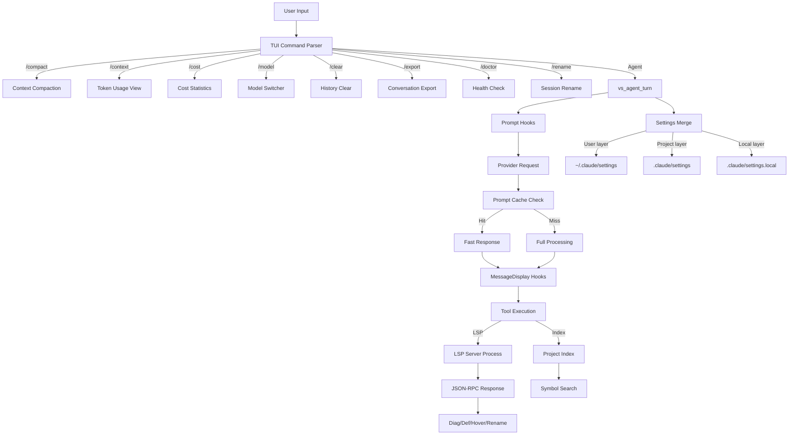

# Phase 5: Advanced Features Beyond Parity

### Overview

VibeSolaris Phases 1-4 are complete: all 18 Claude Code built-in tools, 25+ extras, context window awareness, subagent improvements, TUI integration, EndConversation, CLAUDE.md loading, `/fork`, `--bare` mode, auto-memory, accessibility mode, image display, conversation save/restore, X11/Wayland/Cocoa Computer Use, checkpoints, AutoDream, Auto Mode, Agent Teams, Plugins, Code Review, CLI flags, and more. **533 tests, 477 KB binary.**

Phase 5 goes beyond Claude Code parity to implement advanced features that improve developer experience: full LSP integration, prompt caching, multi-layer settings, additional TUI commands, hook enhancements, project indexing, and session management.

**Phase 5 Status: Complete — 887 tests, 548 KB binary, 28 test suites. All phases 1-7 done.**

### Goals

- Full LSP server spawning and JSON-RPC communication
- Prompt caching for faster repeated turns
- Multi-layer settings system matching Claude Code's .claude/ hierarchy
- 15+ additional TUI commands for better workflow
- Enhanced hooks (MessageDisplay, prompt hooks, async, HTTP)
- Project index for deep codebase awareness
- Session management (export, rename, resume)
- Keep binary under 5MB
- All tests passing

---

### Step 1: Full LSP Implementation

**Problem**: `src/lsp.c` is a placeholder — it detects the LSP server via env vars but never spawns it or exchanges JSON-RPC messages. Claude Code has real LSP integration for diagnostics, go-to-definition, hover, and rename.

**Solution**: Implement a full JSON-RPC LSP client that spawns the server, exchanges messages, and parses responses.

#### Changes to `src/lsp.c`
- `vs_lsp_init()`: spawn the configured LSP server as a child process with stdio pipes
- `vs_lsp_initialize()`: send `initialize` request with capabilities, receive server info
- `vs_lsp_diagnostics(file_path)`: send `textDocument/diagnostic`, parse and return findings
- `vs_lsp_definition(file_path, line, col)`: send `textDocument/definition`, return target location
- `vs_lsp_hover(file_path, line, col)`: send `textDocument/hover`, return documentation
- `vs_lsp_rename(file_path, line, col, new_name)`: send `textDocument/rename`, return changes
- `vs_lsp_shutdown()`: send `shutdown` + `exit`, close pipes
- JSON-RPC message builder/parser with proper content-length framing
- File event notifications (`textDocument/didOpen`, `didChange`, `didClose`)
- Server lifecycle management per project root
- Timeout handling for unresponsive servers

#### Changes to `include/vibesolaris.h`
- Add `VSLSPServer` type (pid, in_fd, out_fd, initialized, root_path)
- Add `lsp_servers` array and `lsp_server_count` to `VSContext`
- Add `VS_MAX_LSP_SERVERS` = 4
- Add function declarations for full LSP operations

#### Changes to `src/agent.c`
- Extend `lsp` directive to support: diagnostics, definition, hover, rename
- Call `vs_lsp_init()` before first LSP operation in a turn
- Send file change notifications after write/edit/multi_edit

#### Changes to `src/util.c`
- In `vs_shutdown()`: call `vs_lsp_shutdown()` for all servers

#### Changes to `Makefile`
- No changes needed (lsp.c already in build)

#### Unit Tests
- `tests/lsp_test.c` (30 tests): server spawn, initialize, diagnostics, definition, hover, rename, shutdown, timeout, multiple servers, file events

---

### Step 2: Prompt Caching

**Problem**: Claude Code uses prompt caching to speed up repeated turns. When the system prompt and earlier messages are cached, only the new content needs to be processed. We have no cache control annotations.

**Solution**: Add prompt caching support for providers that support it (Anthropic, OpenAI).

#### Changes to `src/provider.c`
- Add cache control annotations to system prompt sections:
  - Anthropic: `{"cache_control": {"type": "ephemeral"}}` on system prompt blocks
  - OpenAI: `"cache_control": "ephemeral"` on messages
- Track cache hit rate per conversation
- Add `provider_cache_read_tokens` and `provider_cache_write_tokens` to usage tracking
- Auto-enable caching when provider supports it
- Disable caching on `/compact` (prompt changes)

#### Changes to `include/vibesolaris.h`
- Add `prompt_caching_enabled` field to `VSContext`
- Add `provider_cache_read_tokens` field to `VSContext`
- Add `provider_cache_write_tokens` field to `VSContext`

#### Changes to `src/tui.c`
- Add `/cache on|off|status` command
- Show cache hit rate in status bar when verbose mode

#### Changes to `src/util.c`
- In `vs_init()`: detect provider caching support and enable by default

#### Unit Tests
- `tests/prompt_cache_test.c` (15 tests): cache annotation insertion, cache stats tracking, enable/disable, provider detection

---

### Step 3: Multi-Layer Settings System

**Problem**: Claude Code has a three-layer settings system: project-level (`.claude/settings.json`), local (`.claude/settings.local.json`), and user-level (`~/.claude/settings.json`). Settings merge with local overriding project overriding user. We have only a single config file.

**Solution**: Implement three-layer settings with proper merge semantics.

#### New file: `src/settings.c` (200 lines)
- `vs_settings_load_user()`: load `~/.claude/settings.json`
- `vs_settings_load_project()`: load `.claude/settings.json` (project root)
- `vs_settings_load_local()`: load `.claude/settings.local.json`
- `vs_settings_merge()`: merge three layers (local > project > user)
- Settings include: permissions, hooks, env vars, model preferences, MCP servers
- `vs_settings_save_local()`: save user-specific overrides
- Detect project root via git root or directory with `.claude/`

#### Changes to `src/util.c`
- In `vs_init()`: call multi-layer settings load instead of single config
- Merge settings into `VSContext` fields

#### Changes to `include/vibesolaris.h`
- Add `VSSettingsLayer` enum (USER, PROJECT, LOCAL)
- Add `VSSettings` type with merged fields
- Add function declarations for settings operations

#### Changes to `src/tui.c`
- Add `/config` command: open settings interface
- Add `/config layer` command: show current settings layers

#### Changes to `Makefile`
- Add `src/settings.o` to CORE

#### Unit Tests
- `tests/settings_test.c` (25 tests): three-layer load, merge priority, project root detection, save local, override semantics

---

### Step 4: Additional TUI Commands

**Problem**: Claude Code has many TUI commands we don't have: `/compact`, `/context`, `/cost`, `/model`, `/clear`, `/export`, `/doctor`, `/bashes`, `/hooks`, `/mcp`, `/memory`, `/permissions`, `/rename`.

**Solution**: Implement all missing TUI commands.

#### `/compact [instructions]`
- Trigger immediate context compaction with optional focus instructions
- Calls `agent_compact()` in `src/agent.c`
- Shows token count before/after

#### `/context`
- Visualize current context usage: tokens used, tokens remaining, percentage
- Show breakdown: system prompt, history, agent history, attachments
- Use `vs_estimate_request_tokens()` for calculation

#### `/cost`
- Show token usage statistics for the current session
- Display input tokens, output tokens, cache hits, estimated cost
- Use provider pricing data (configurable)

#### `/model [name]`
- List available models or switch to a specific model
- Show current model and provider
- Update system prompt after switch

#### `/clear`
- Clear conversation history (but keep CLAUDE.md and system prompt)
- Reset token counts

#### `/export [filename]`
- Export conversation to file (JSONL or markdown format)
- Default: `conversation_<timestamp>.md`

#### `/doctor`
- Check installation health: provider connectivity, MCP servers, LSP servers, disk space
- Report issues and suggestions

#### `/bashes`
- List and manage background bash tasks (monitors)
- Show running monitors with output preview

#### `/hooks`
- Manage hook configurations (list, add, remove)
- Extended from existing hooks system

#### `/mcp`
- Manage MCP server connections (list, add, remove, refresh)
- Show tool count per server

#### `/memory`
- Edit CLAUDE.md memory files
- Search, list, add, delete memory entries

#### `/permissions`
- View or update tool permissions
- Extended from existing permission system

#### `/rename [name]`
- Rename current session/conversation

#### Changes to `src/tui.c`
- Add all new commands to input handling
- Update tab completion array
- Update `/help` output

#### Changes to `src/agent.c`
- Add `compact` directive for manual compaction trigger

#### Changes to `src/util.c`
- Add `vs_conversation_export()` for `/export`
- Add `vs_doctor_check()` for `/doctor`

#### Unit Tests
- `tests/tui_commands_test.c` (20 tests): compact, context, cost, model, clear, export, doctor, bashes, hooks, mcp, memory, permissions, rename

---

### Step 5: Hook Enhancements

**Problem**: Claude Code hooks support more events than we have: MessageDisplay (streaming output hooks), prompt hooks (modify prompts before sending), async hooks (non-blocking), and HTTP hooks (webhook notifications).

**Solution**: Extend the hooks system with new event types.

#### Changes to `src/hooks.c`
- Add `VS_HOOK_MESSAGE_DISPLAY` event type
- Add `VS_HOOK_PROMPT` event type (pre-send prompt modification)
- Add async hook support via pthread (non-blocking execution)
- Add HTTP hook support (POST to webhook URL with JSON payload)
- Hook input/output JSON format matching Claude Code spec
- Exit code handling for hooks (0 = proceed, non-zero = block)

#### Changes to `include/vibesolaris.h`
- Add hook event type constants
- Add `VSHookEvent` type with session_id, turn_id, tool_name, input, output
- Add async hook fields to `VSHook` struct

#### Changes to `src/agent.c`
- Call prompt hooks before sending request to provider
- Call MessageDisplay hooks during streaming output

#### Changes to `src/tui_stream.c`
- Call MessageDisplay hooks as tokens arrive

#### Unit Tests
- `tests/hooks_extended_test.c` (20 tests): MessageDisplay, prompt hooks, async execution, HTTP webhooks, exit codes, JSON format

---

### Step 6: Project Index

**Problem**: Claude Code builds a project index for deep codebase awareness — understanding file relationships, function signatures, and import dependencies. We have `graph.c` for file structure but no semantic index.

**Solution**: Add a project index that tracks symbols, imports, and dependencies.

#### New file: `src/project_index.c` (250 lines)
- `vs_project_index_build(root)`: scan project and build index
- Parse common languages for function/class/method declarations
- Track import/include relationships between files
- Store index in `~/.vibesolaris/index/<project_hash>/`
- `vs_project_index_search(query)`: find symbols matching a query
- `vs_project_index_references(symbol)`: find files referencing a symbol
- `vs_project_index_dependencies(file)`: find files depended on by a file
- Incremental updates: only re-scan changed files
- Index format: JSON with symbol table and dependency graph

#### Changes to `src/agent.c`
- Add `project_index` directive for agent to query the index
- Auto-build index on first turn in a new project

#### Changes to `include/vibesolaris.h`
- Add `VSProjectIndex` type
- Add `project_index` field to `VSContext`
- Add function declarations

#### Changes to `src/util.c`
- In `vs_init()`: check for existing index or trigger build

#### Changes to `Makefile`
- Add `src/project_index.o` to CORE

#### Unit Tests
- `tests/project_index_test.c` (20 tests): build index, search symbols, find references, dependencies, incremental update, cache invalidation

---

### Step 7: Session Management

**Problem**: Claude Code has robust session management: export conversations, rename sessions, and resume with full context. We have basic save/restore but missing export and rename.

**Solution**: Implement full session management.

#### Changes to `src/util.c`
- `vs_conversation_export(ctx, filename, format)`: export as JSONL or markdown
- `vs_conversation_rename(old_id, new_name)`: rename a saved conversation
- `vs_conversation_resume(id)`: load and continue a conversation

#### Changes to `src/tui.c`
- Add `/export [filename]` command
- Add `/rename [name]` command
- Add `/resume [id]` command (extends existing --resume flag)

#### Unit Tests
- `tests/session_mgmt_test.c` (15 tests): export JSONL, export markdown, rename, resume, list conversations

---

### Step 8: Documentation and Final Verification

**Problem**: All documentation needs updating to reflect Phase 5 features.

**Solution**: Update all docs and run full verification.

#### Changes to `CLAUDE-CODE-PARITY.md`
- Add sections for LSP, prompt caching, multi-layer settings, new TUI commands, hook enhancements, project index, session management

#### Changes to `README.md`
- Add Phase 5 features to the feature list
- Update usage examples

#### Changes to `TUI-UPGRADE.md`
- Document all new TUI commands

#### Verification
- `make clean && make vibesolaris && make test`
- All existing 533 tests pass plus all new tests (~200 new tests)
- Binary size under 5MB
- LSP verification: diagnostics work with a configured server
- Prompt caching verification: cache annotations present in requests

---

# Architecture Diagram

# Testing Strategy

### Test Approach
- `tests/lsp_test.c` (30 tests): server spawn, JSON-RPC, diagnostics, definition, hover, rename
- `tests/prompt_cache_test.c` (15 tests): cache annotations, stats, enable/disable
- `tests/settings_test.c` (25 tests): three-layer load, merge, project root detection
- `tests/tui_commands_test.c` (20 tests): all new TUI commands
- `tests/hooks_extended_test.c` (20 tests): MessageDisplay, prompt, async, HTTP hooks
- `tests/project_index_test.c` (20 tests): build, search, references, dependencies
- `tests/session_mgmt_test.c` (15 tests): export, rename, resume

### Validation
- All 533 existing tests continue passing
- ~145 new tests across 7 test files
- Full build: `make clean && make vibesolaris && make test`
- Binary size: under 5MB
- LSP verification: real server communication works
- Settings verification: three-layer merge produces correct result

# Risks & Trade-offs

### Risks

1. **LSP server spawning**: Managing child processes for LSP servers adds complexity. Mitigation: timeout handling, proper cleanup on shutdown, max 4 servers.
2. **JSON-RPC parsing**: Full JSON-RPC framing is complex. Mitigation: use existing JSON parsing infrastructure, handle content-length framing carefully.
3. **Prompt caching provider differences**: Each provider has different cache annotation formats. Mitigation: provider-specific annotation functions, graceful fallback.
4. **Settings merge conflicts**: Three-layer merge can have unexpected interactions. Mitigation: clear priority order, test all combinations.
5. **Project index accuracy**: Parsing source code for symbols is heuristic-based. Mitigation: support common languages only, allow manual index refresh.
6. **Hook async execution**: Non-blocking hooks add threading complexity. Mitigation: bounded thread pool, timeout on hook execution.

### Trade-offs

- **LSP is stdio-only**: No TCP/WSL LSP servers. Covers most common servers (typescript-language-server, pyright, clangd).
- **Prompt caching is provider-specific**: No universal cache protocol. Each provider handled separately.
- **Project index is heuristic**: No full AST parsing. Regex-based symbol extraction for common languages.
- **Settings are JSON-only**: No YAML or other formats. Simple and portable.
- **Hooks are shell-based**: No in-process hook execution. Matches Claude Code's approach.
